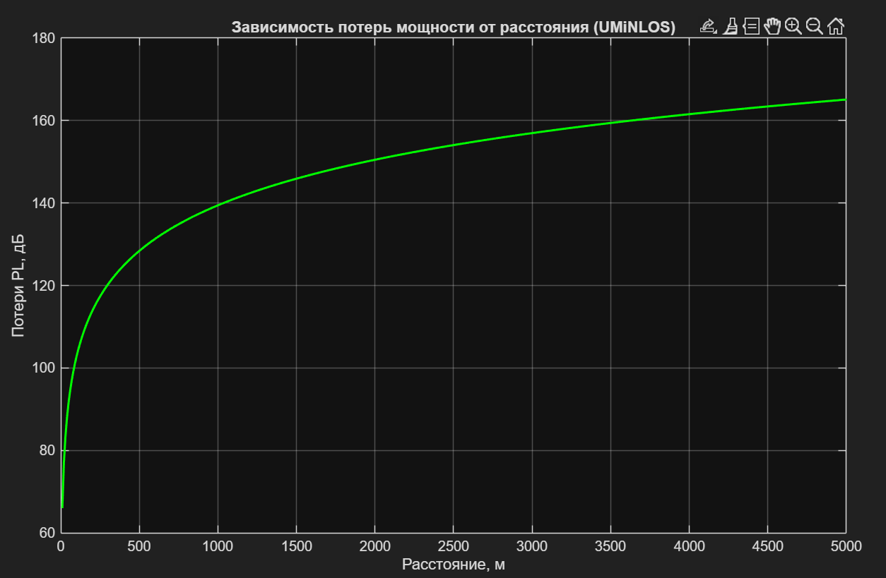
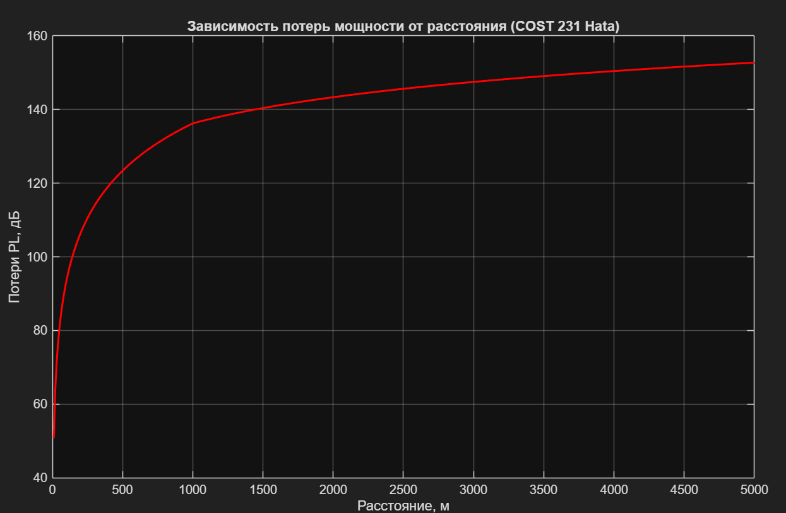
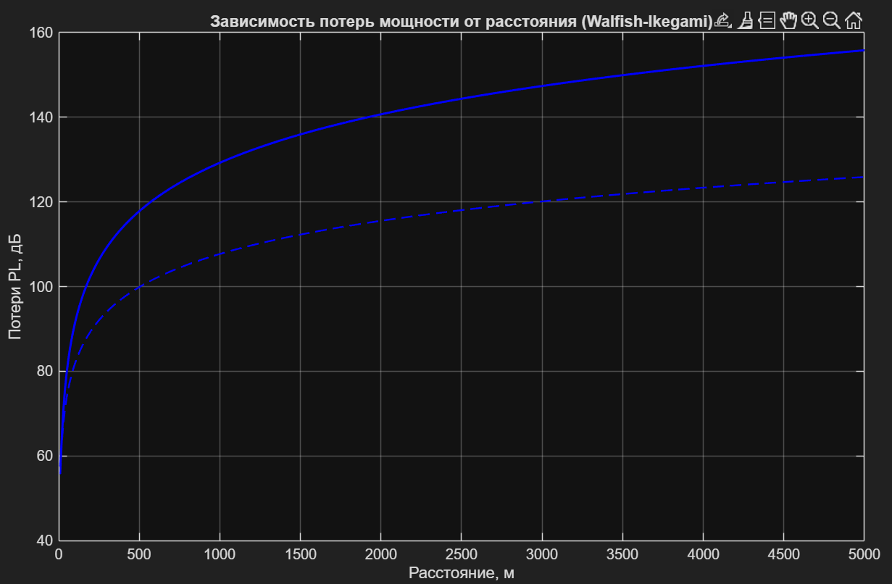
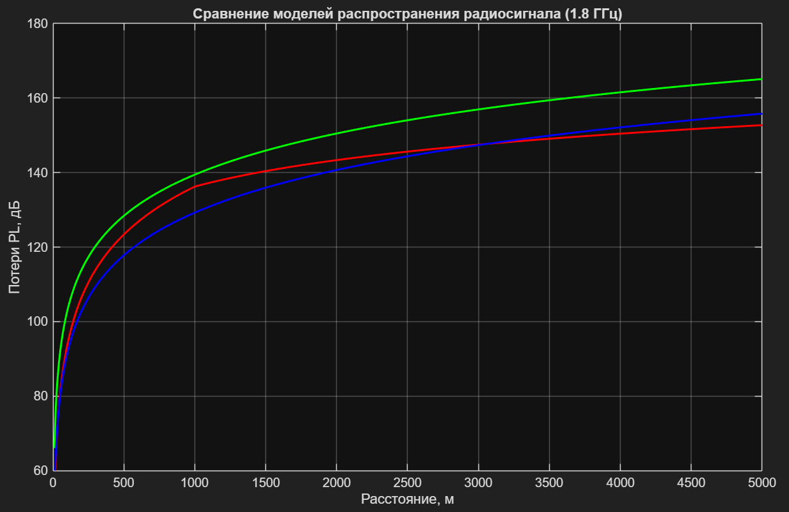
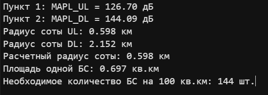

#  Лабораторная работа №2


## Задачи практической работы
1. Выполните расчет бюджета восходящего канала, используя входные данные и определите уровень максимально допустимых потерь сигнала MAPL_UL. 
2. Выполните расчет бюджета нисходящего канала, используя входные данные и определите уровень максимально допустимых потерь сигнала MAPL_DL. 
3. Постройте зависимость величины входных потерь радиосигнала от расстояния между приемником и передатчиком по всем трем описанным в п.2.2 моделям. Выберите нужную модель для заданных условий. 
4. Определите радиус базовой станции в восходящем и нисходящем каналах. По меньшему из полученных значений рассчитайте площадь одной базовой станции и, исходя из заданной площади, вычислите требуемое количество базовых станций (сайтов), необходимое для обеспечения непрерывного покрытия на этой территории. 
5. Составьте отчет. Отчет должен содержать титульный лист, содержание, цель и задачи работы, теоретические сведения, исходные данные, этапы выполнения работы, сопровождаемые скриншотами и графиками, демонстрирующими успешность выполнения, результирующими таблицами, ответы на контрольные вопросы, и заключение и ссылка в виде QR-кода на репозиторий с кодом (git).

## Результаты:
1) Выполнил расчет бюджета восходящего канала, используя входные данные и определил уровень максимально допустимых потерь сигнала MAPL_UL.
```
clc

P_tx_BS = 46;
P_tx_UE = 24;
count_sector_one_BS = 3;
antenna_gain_BS = 21;
GainMIMO = 3;
M_penetration = 15;
M_interf = 1;
f_GHz = 1.8;
f_MHz = 1800;
NF_BS = 2.4;
NF_UE = 6.0;
SINR_DL = 2.0;
SINR_UL = 4.0;
FeederLoss = 2.9;

%% 1 
BW_UL = 10e6;
ThermalNoise = -174 + 10*log10(BW_UL);
RxSensBS = NF_BS + ThermalNoise + SINR_UL;
MAPL_UL = P_tx_UE - FeederLoss + antenna_gain_BS + GainMIMO - RxSensBS - M_interf - M_penetration;
fprintf('Пункт 1: MAPL_UL = %.2f дБ\n', MAPL_UL);
```


2) Выполнил расчет бюджета нисходящего канала, используя входные данные и определил уровень максимально допустимых потерь сигнала MAPL_DL.
```
%% 2
BW_DL = 20e6;
ThermalNoise_DL = -174 + 10*log10(BW_DL);
RxSensUE = ThermalNoise_DL + NF_UE + SINR_DL;
MAPL_DL = P_tx_BS - FeederLoss + antenna_gain_BS + GainMIMO - RxSensUE - M_interf - M_penetration;
fprintf("Пункт 2: MAPL_DL = %.2f дБ\n", MAPL_DL);
```


3) Построил зависимость величины входных потерь радиосигнала от расстояния между приемником и передатчиком по всем трем описанным в п.2.2 моделям. Выбрал нужную модель для заданных условий. 
```
%% 3
%% UMiNLOS
d_m = 10:10:5000;
PL_UMiNLOS = 26 * log10(f_GHz) + 22.7 + 36.7 * log10(d_m);
figure;
plot(d_m, PL_UMiNLOS, "g-", 'LineWidth', 1.5);
grid on;
title('Зависимость потерь мощности от расстояния (UMiNLOS)');
xlabel('Расстояние, м');
ylabel('Потери PL, дБ');

%% OKUMURA_HATA
A = 46.3;
B = 33.9;
h_BS = 30;
h_ms = 1.5;
a_hms = 3.2 * (log10(11.75 * h_ms))^2 - 4.97;
lclutter = 0;
d_km = d_m / 1000;

s_more1 = 44.9 - 6.55 * log10(f_MHz);
s_less1 = (47.88 + 13.9*log10(f_MHz) - 13.9*log10(h_BS)) * (1 / log10(50));

s = zeros(size(d_km));
s(d_km < 1) = s_less1;
s(d_km >= 1) = s_more1;

PL_HATA = A + B * log10(f_MHz) - 13.82 * log10(h_BS) - a_hms + s .* log10(d_km) + lclutter;
figure;
plot(d_m, PL_HATA, 'r-', 'LineWidth', 1.5);
grid on;
title('Зависимость потерь мощности от расстояния (COST 231 Hata)');
xlabel('Расстояние, м');
ylabel('Потери PL, дБ');

%% Walfish-Ikegami
h_roof = 20;
w = 20;
b = 40;
phi = 90;
L_los = 42.6 + 20*log10(f_MHz) + 26*log10(d_km);
L0 = 32.44 +20 * log10(f_MHz) + 20*log10(d_km);
ori = 4.0 - 0.114*phi;
L2 = -16.9 - 10 * log10(w) + 10 * log10(f_MHz) + 20 * log10(h_roof - h_ms) + ori;
Delta_h = h_roof;
L11 = -18 * log10(1 + h_BS - Delta_h);
ka = 54;
kd = 18;
kf = -4 + 0.7 * (f_MHz / 925 - 1);
L1 = L11 + ka +kd * log10(d_km) + kf * log10(f_MHz) - 9 * log10(b);
L_diff = L1 + L2;
L_nlos = L0 + max(0, L_diff);
figure;
plot(d_m, L_nlos, 'b-', 'LineWidth', 1.5);
hold on;
plot(d_m, L_los, 'b--', 'LineWidth', 1.2);
grid on;
title('Зависимость потерь мощности от расстояния (Walfish-Ikegami)');
xlabel('Расстояние, м');
ylabel('Потери PL, дБ');

%% Сравнительный график всех моделей
figure;
plot(d_m, PL_UMiNLOS, 'g-', 'LineWidth', 1.5);
hold on;
plot(d_m, PL_HATA, 'r-', 'LineWidth', 1.5);
plot(d_m, L_nlos, 'b-', 'LineWidth', 1.5);
grid on;
title('Сравнение моделей распространения радиосигнала (1.8 ГГц)');
xlabel('Расстояние, м');
ylabel('Потери PL, дБ');
xlim([0, 5000]);
ylim([60, 180]);
```





4) Определил радиус базовой станции в восходящем и нисходящем каналах. По меньшему из полученных значений рассчитал площадь одной базовой станции и, исходя из заданной площади, вычислил требуемое количество базовых станций (сайтов), необходимое для обеспечения непрерывного покрытия на этой территории. 
```
%% 4
R_UL_macro = interp1(PL_HATA, d_km, MAPL_UL);
R_DL_macro = interp1(PL_HATA, d_km, MAPL_DL);
R_macro = min(R_DL_macro, R_UL_macro);
S_macro_total = 100;
S_site_macro = 1.95 * (R_macro^2);
N_macro = ceil(S_macro_total / S_site_macro);

fprintf('Радиус соты UL: %.3f км\n', R_UL_macro);
fprintf('Радиус соты DL: %.3f км\n', R_DL_macro);
fprintf('Расчетный радиус соты: %.3f км\n', R_macro);
fprintf('Площадь одной БС: %.3f кв.км\n', S_site_macro);
fprintf('Необходимое количество БС на 100 кв.км: %d шт.\n\n', N_macro);
```

## Выводы
1. В ходе выполнения лабораторной работы были рассчитаны бюджеты
восходящего (UL) и нисходящего (DL) каналов связи для сети LTE на несу
щей частоте1.8 ГГц.МаксимальнодопустимыепотерисоставилиMAPLUL =
126.70 дБ и MAPLDL = 144.09дБ. Разница в 17.39 дБ обусловлена огра
ниченной мощностью смартфона (24 дБм) по сравнению с передатчиком БС
(46 дБм).
2. Построены и исследованы три модели распространения радиосигна
ла: UMiNLOS, COST 231 Hata и Walfish-Ikegami. Для городской макросети
выбрана модель COST 231 Hata, а для закрытых помещений — UMiNLOS.
3. Численнойинтерполяциейопределенырадиусыдействиясоты:RUL =
0.598 км и RDL = 2.152 км. Расчетный радиус соты ограничен восходящим
каналом: R = 0.598 км.
4. Рассчитана площадь покрытия одной 3-секторной БС: Ssite =
1.95R2 ≈ 0.697км2. Для обеспечения сплошного покрытия территории
площадью 100 км2 необходимо развернуть 144 базовые станции.
