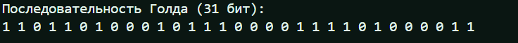
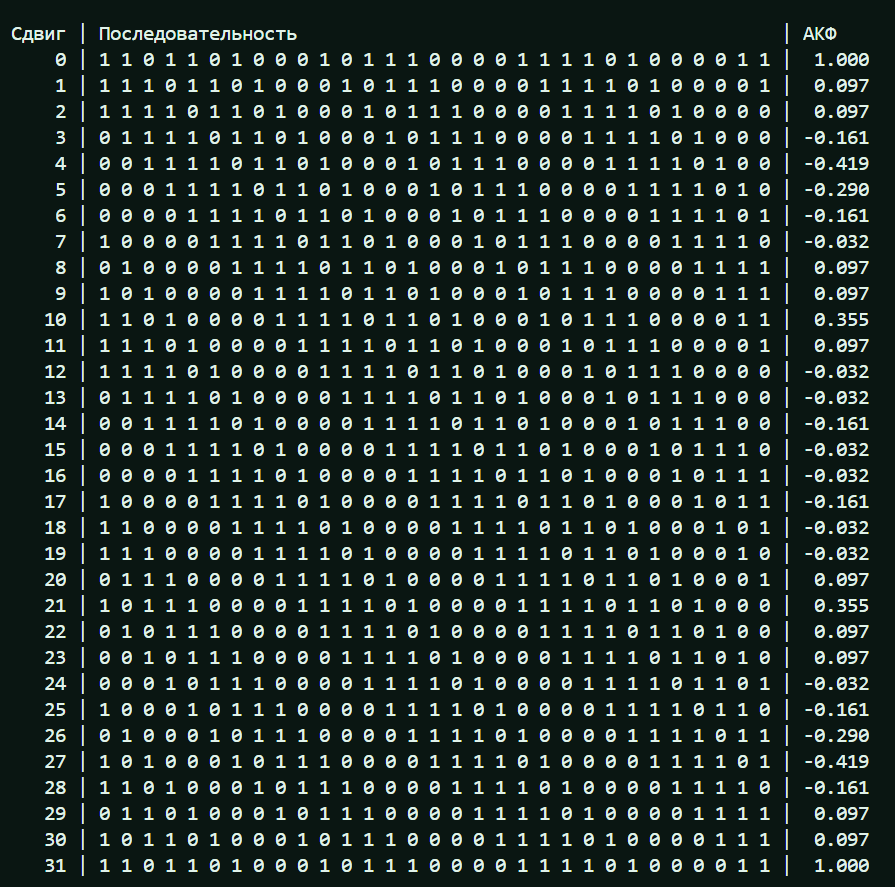
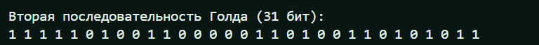
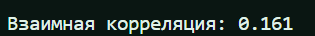
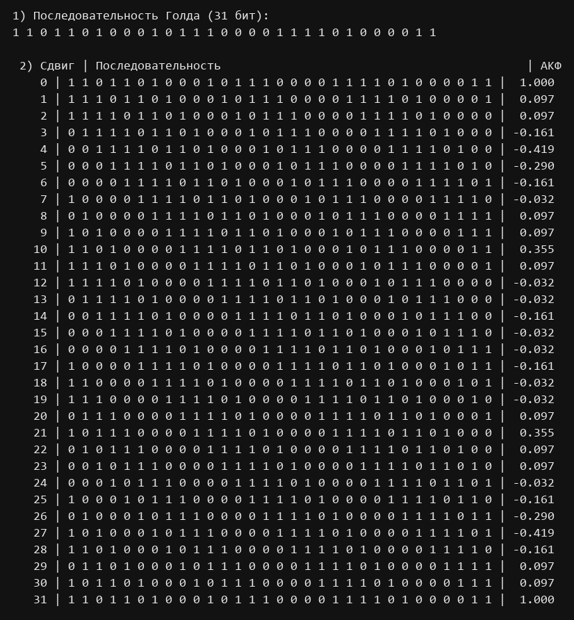
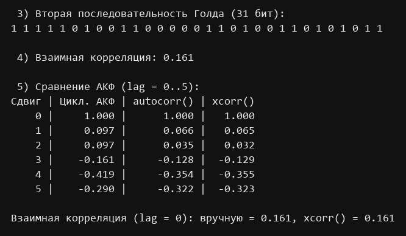
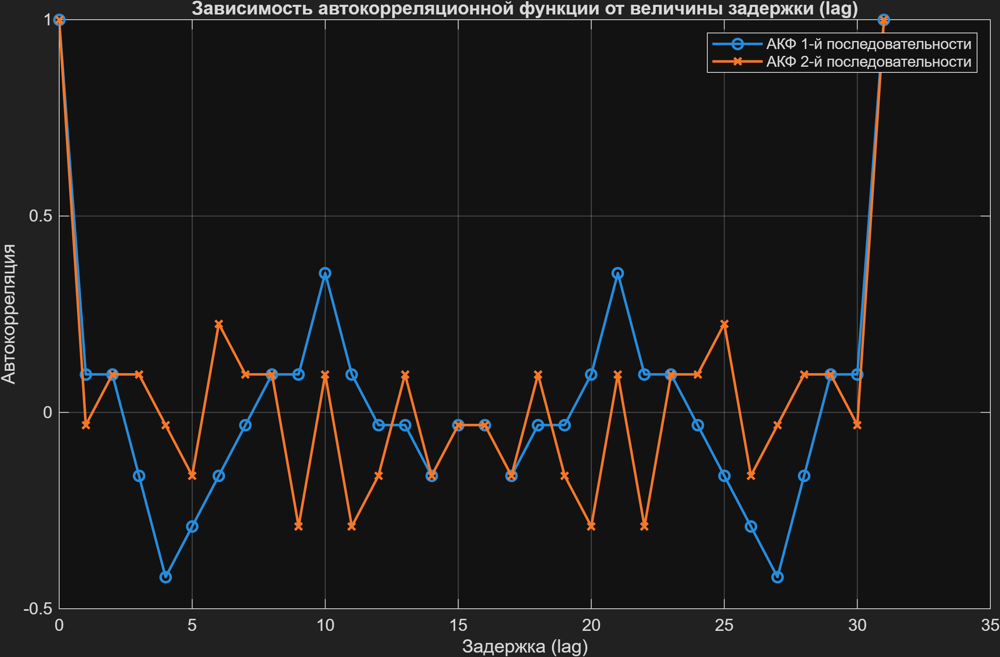

# Лабораторная работа №4

## Задачи практической работы
1. Написать программу на языке C/C++ для генерации последовательности Голда по схеме рис. 4.5 (нечётная группа ИКС-433, вариант 14: `x = 14 = 01110`, `y = 21 = 10101`) и вывести её на экран.
2. Сделать поэлементный циклический сдвиг последовательности, посчитать автокорреляцию и сформировать таблицу значений.
3. Сформировать вторую последовательность Голда (`x = x + 1 = 15 = 01111`, `y = y - 5 = 16 = 10000`).
4. Вычислить значение взаимной корреляции исходной и новой последовательностей и вывести в терминал.
5. Проделать шаги 1–4 в MATLAB с использованием функций `xcorr()` и `autocorr()`, сравнить результаты MATLAB и C/C++.
6. Вывести на график в MATLAB функцию автокорреляции в зависимости от величины задержки (`lag`).
7. Составить отчёт с титульным листом, содержанием, теорией, исходными данными, этапами выполнения, скриншотами, графиками, ответами на контрольные вопросы, выводами и ссылкой (QR-кодом) на репозиторий Git.

---

## Результаты:

### 1) Сгенерировал первую последовательность Голда (31 бит) по схеме рис. 4.5 (`lab_4.c`):
```c
// %% 1
int x[5] = {0, 1, 1, 1, 0};
int y[5] = {1, 0, 1, 0, 1};
int gold[31];

for (int i = 0; i < 31; i++) {
    gold[i] = x[4] ^ y[4];

    int fb_x = x[3] ^ x[4];
    int fb_y = y[1] ^ y[4];

    for (int j = 4; j > 0; j--) {
        x[j] = x[j - 1];
        y[j] = y[j - 1];
    }

    x[0] = fb_x;
    y[0] = fb_y;
}

printf("Последовательность Голда (31 бит):\n");
for (int i = 0; i < 31; i++) {
    printf("%d ", gold[i]);
}
printf("\n");
```


---

### 2) Выполнил циклический сдвиг и построил таблицу автокорреляции (`lab_4.c`):
```c
// %% 2
int shifted[31];
for (int i = 0; i < 31; i++) {
    shifted[i] = gold[i];
}

printf("\nСдвиг | Последовательность                                            | АКФ\n");
for (int s = 0; s <= 31; s++) {
    int match = 0;
    int mismatch = 0;
    for (int i = 0; i < 31; i++) {
        if (gold[i] == shifted[i]) {
            match++;
        } else {
            mismatch++;
        }
    }
    double acf = (double)(match - mismatch) / 31.0;

    printf("%5d | ", s);
    for (int i = 0; i < 31; i++) {
        printf("%d ", shifted[i]);
    }
    printf("| %6.3f\n", acf);

    int last = shifted[30];
    for (int i = 30; i > 0; i--) {
        shifted[i] = shifted[i - 1];
    }
    shifted[0] = last;
}
```


---

### 3) Сформировал вторую последовательность Голда (`x2 = 15`, `y2 = 16`) (`lab_4.c`):
```c
// %% 3
int x2[5] = {0, 1, 1, 1, 1};
int y2[5] = {1, 0, 0, 0, 0};
int gold2[31];

for (int i = 0; i < 31; i++) {
    gold2[i] = x2[4] ^ y2[4];

    int fb_x = x2[3] ^ x2[4];
    int fb_y = y2[1] ^ y2[4];

    for (int j = 4; j > 0; j--) {
        x2[j] = x2[j - 1];
        y2[j] = y2[j - 1];
    }

    x2[0] = fb_x;
    y2[0] = fb_y;
}

printf("\nВторая последовательность Голда (31 бит):\n");
for (int i = 0; i < 31; i++) {
    printf("%d ", gold2[i]);
}
printf("\n");
```


---

### 4) Вычислил взаимную корреляцию первой и второй последовательностей (`lab_4.c`):
```c
// %% 4
int match2 = 0;
int mismatch2 = 0;
for (int i = 0; i < 31; i++) {
    if (gold[i] == gold2[i]) {
        match2++;
    } else {
        mismatch2++;
    }
}
double ccf = (double)(match2 - mismatch2) / 31.0;

printf("\nВзаимная корреляция: %.3f\n", ccf);
```


---

### 5) Повторил шаги 1–4 в MATLAB, выполнил расчёт через `autocorr()` и `xcorr()` и сравнил результаты (`lab_4.m`):
```matlab
%% 5
[acf_auto, lags_auto] = autocorr(gold, 'NumLags', 30);
[xc_val, lags_xc] = xcorr(2*gold - 1, 2*gold2 - 1, 'coeff');
[acf_xcorr, lags_ac] = xcorr(2*gold - 1, 'coeff');

fprintf('\n 5) Сравнение АКФ (lag = 0..5):\n');
fprintf('Сдвиг | Цикл. АКФ | autocorr() | xcorr()\n');
for s = 0:5
    fprintf('%5d | %9.3f | %10.3f | %7.3f\n', s, acf(s + 1), acf_auto(s + 1), acf_xcorr(31 + s));
end
fprintf('\nВзаимная корреляция (lag = 0): вручную = %.3f, xcorr() = %.3f\n', ccf, xc_val(31));
```



---

### 6) Построил график автокорреляционной функции от величины задержки (`lag`) (`lab_4.m`):
```matlab
%% 6
shifted2 = gold2;
acf2 = zeros(1, 32);

for s = 0:31
    match = sum(gold2 == shifted2);
    mismatch = sum(gold2 ~= shifted2);
    acf2(s + 1) = (match - mismatch) / 31;
    shifted2 = [shifted2(31) shifted2(1:30)];
end

figure;
plot(0:31, acf, '-o', 'LineWidth', 1.5);
hold on;
plot(0:31, acf2, '-x', 'LineWidth', 1.5);
grid on;
title('Зависимость автокорреляционной функции от величины задержки (lag)');
xlabel('Задержка (lag)');
ylabel('Автокорреляция');
legend('АКФ 1-й последовательности', 'АКФ 2-й последовательности');
hold off;
```


---

## Защита (дополнительно)
* [4_deff.c](4_deff.c) — автоматизированная проверка последовательности произвольной длины на соответствие трём свойствам М-последовательности (сбалансированность, цикличность, автокорреляция).

---

## Выводы
1. Реализован генератор кодов Голда на языках C и MATLAB для варианта №14 (группа ИКС-433, схема рис. 4.5); получены сбалансированные 31-битные последовательности.
2. Построена таблица циклического сдвига и значений АКФ: зафиксированы корреляционные пики `+1.000` при сдвигах `0` и `31`, а также симметрия боковых значений относительно середины периода.
3. Вычислена взаимная корреляция двух последовательностей Голда: получено значение `0.161` (`18` совпадений против `13` несовпадений), что подтверждает низкий уровень взаимных помех.
4. Ручной расчёт в C и MATLAB совпал полностью. При нулевой задержке (`lag = 0`) встроенные функции `autocorr()` и `xcorr()` также дают идентичные результаты (`1.000` для АКФ и `0.161` для ВКФ), а на ненулевых сдвигах отличаются из-за линейного сдвига без зацикливания и центрирования в `autocorr()`.
